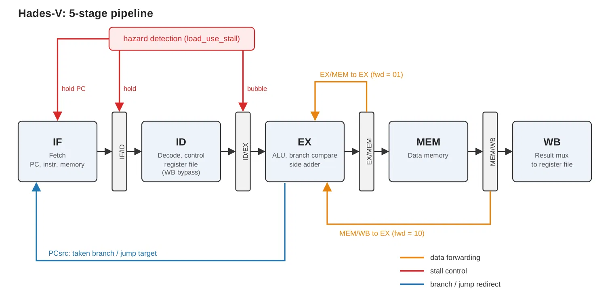
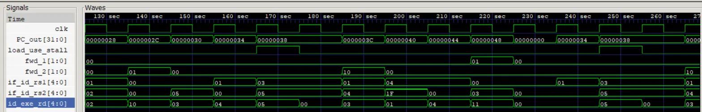

# Hades-V

Arnab Ghosh

A 5-stage pipelined RV32I RISC-V CPU written from scratch in SystemVerilog, with data forwarding, load-use hazard detection, and control-flow handling. Simulated with Icarus Verilog and GTKWave. FPGA bring-up is the next goal.

This is a passion project, built out of personal interest in computer architecture and digital design rather than as coursework for a class.

## Documents

- [Control signal and ALU encoding reference](docs/control-encoding.md): the custom 4-bit `alu_control` encoding, control signals, forwarding encoding, and stall behavior
- <!-- Add: supported instruction list, project report, or notes if you write them -->

## Design

| Feature          | Hades-V                                                        |
| ---------------- | -------------------------------------------------------------- |
| ISA              | RISC-V RV32I (no fence, ecall, ebreak, or CSRs)                |
| Pipelining       | 5 stages: IF, ID, EX, MEM, WB                                  |
| Data forwarding | EX/MEM and MEM/WB to the ALU operands, plus register file bypass in ID |
| Hazard handling  | 1-cycle stall on load-use, bubble inserted into ID/EX          |
| Control flow     | Branch and jump resolved in EX, `PCsrc` routed directly to fetch |
| Cache            | none                                                           |
| FPGA             | not yet                                                        |

The datapath uses plain signal ports between modules instead of structs or packages, so every connection is visible at the module boundary.

<!-- Add a pipeline diagram here, for example:

Showing forwarding paths and stall control in different colors makes it much easier to read. -->

## Simulation

Toolchain: [Icarus Verilog](https://steveicarus.github.io/iverilog/) and [GTKWave](https://gtkwave.sourceforge.net/), with sources compiled using `-g2012`.

```
iverilog -g2012 -o sim_out rtl/*.sv tb/<testbench>.sv
vvp sim_out
gtkwave waves.vcd
```

Replace `<testbench>` with the testbench to run. It writes `waves.vcd`, which you can open in GTKWave to inspect the pipeline cycle by cycle.

The main test program is a small array-sum loop, surrounded by jump cases and load-then-branch cases. Together they exercise the hazards that are most likely to go wrong: back-to-back data dependencies (forwarding), a load followed immediately by its consumer (load-use stall), and control-flow redirects.



## Repository layout

```
rtl/   synthesizable SystemVerilog sources
tb/    testbenches
sim/   simulation support files
docs/  design documentation
```

## Implementation

Not started. The plan is FPGA bring-up after the simulation test coverage is complete. Board not yet chosen.

## References

- Sarah L. Harris and David Harris. *Digital Design and Computer Architecture: RISC-V Edition*. Morgan Kaufmann, 2021.
- [Harris & Harris lecture playlist on YouTube](https://www.youtube.com/watch?v=lrN-uBKooRY&list=PLh8QClfSUTcbfTnKUz_uPOn-ghB4iqAhs&index=1), from the authors' own channel
## License

MIT. See [LICENSE](LICENSE).